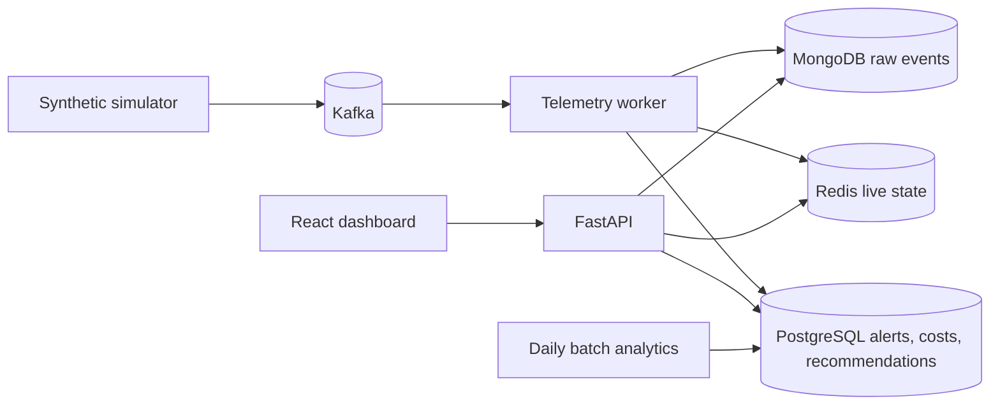

# FleetGuard

### Real-Time Fleet Intelligence & Cost Optimisation Platform

FleetGuard turns connected-vehicle telemetry into a clear operational chain:

**Telemetry → Behaviour → Waste → Financial impact → Recommended action**

The demo focuses on engine idling and fuel cost. It explains what happened, estimates the fuel and currency impact with a visible formula, raises an alert, and suggests an action. Harsh acceleration and braking signals create coaching alerts.

> **Data declaration:** the simulator generates synthetic vehicle IDs, telemetry, and coordinates. No real driver or private vehicle feed is used.

## What works

- Validated synthetic telemetry with deterministic IDs, duplicates, out-of-order timestamps, and an accelerated idle demo scenario.
- Kafka producer and consumer. The consumer persists unique raw events in MongoDB, updates Redis state, and commits offsets after persistence.
- Deterministic idle detection, cost calculation, savings assumption, PostgreSQL alerts, and recommendations.
- JWT login, fleet-scoped API reads, role-gated alert/recommendation updates, request audit records, and security headers.
- React/TypeScript dashboard with five-second API polling, live state snapshots, alerts, actions, cost view, and clear empty states when data is unavailable.
- PostgreSQL schema and Alembic migrations; Compose definitions for PostgreSQL, MongoDB, Redis, Kafka, API, worker, and frontend.

Several components remain partial; see [implementation progress](docs/IMPLEMENTATION_PROGRESS.md), [performance](docs/PERFORMANCE.md), and [final verification](docs/FINAL_VERIFICATION.md). The 100,000 vehicle/event-per-second figures are **targets only**. No scale benchmark is claimed.

## Architecture



Detailed diagrams and decisions are in [docs/architecture](docs/architecture/README.md). The local Compose deployment is single-node and is not a verified cloud deployment.

## Technology

| Area | Technology |
| --- | --- |
| API | Python 3.13, FastAPI, Pydantic, SQLAlchemy, Alembic |
| Relational store | PostgreSQL 16 |
| Raw events | MongoDB 7 |
| Hot state | Redis 7 |
| Streaming | Apache Kafka 3.9, confluent-kafka |
| Dashboard | React 18, TypeScript, Vite, Nginx |
| Local deployment | Docker Compose |
| Tests | pytest, FastAPI TestClient, opt-in service integration tests |

Vector search and ML are not included: current calculations and recommendations are deterministic and do not need semantic retrieval. See [ADR-005](docs/architecture/ADR-005-vector-and-ai.md).

## Quick start (PowerShell)

Docker Desktop must be running. From the project root:

```powershell
Copy-Item infra/.env.example infra/.env
# For a shared environment, replace all demo passwords and JWT_SECRET_KEY in infra/.env.
docker compose --env-file infra/.env -f infra/docker-compose.yml up --build -d
docker compose --env-file infra/.env -f infra/docker-compose.yml ps
```

Wait for PostgreSQL, MongoDB, Redis, Kafka, backend, and telemetry worker to become healthy/running. The backend container applies Alembic migrations at startup.

Create a local fleet-manager account using credentials you choose:

```powershell
$env:DEMO_ADMIN_EMAIL = 'manager@example.test'
$env:DEMO_ADMIN_PASSWORD = 'choose-a-local-password-with-12-chars'
docker compose --env-file infra/.env -f infra/docker-compose.yml exec -T `
  -e DEMO_ADMIN_EMAIL=$env:DEMO_ADMIN_EMAIL `
  -e DEMO_ADMIN_PASSWORD=$env:DEMO_ADMIN_PASSWORD backend python seed_demo.py
Remove-Item Env:DEMO_ADMIN_EMAIL
Remove-Item Env:DEMO_ADMIN_PASSWORD
```

Open [http://localhost:4173](http://localhost:4173), sign in, and publish a reproducible idle scenario from the project root:

```powershell
backend/.venv/Scripts/python.exe -m simulator.main `
  --vehicle-count 100000 --events 6 --rate 0 --scenario idle `
  --bootstrap-servers localhost:19092
```

The simulator reports the generated synthetic vehicle ID. The worker should detect the 120-second idle threshold after the fifth 30-second-spaced event. The UI polls for updated data every five seconds. See [the complete demo guide](docs/DEMO_GUIDE.md).

## Local development

### Backend

```powershell
cd backend
.\.venv\Scripts\Activate.ps1
python -m pip install -r requirements-dev.txt
Copy-Item .env.example .env
# Edit .env with your local service URLs and a generated JWT_SECRET_KEY.
uvicorn main:app --reload
```

### Frontend

In a second terminal from the repository root:

```powershell
cd frontend
npm ci
npm run dev
```

### API and health

- Dashboard: [http://localhost:4173](http://localhost:4173)
- API root: [http://localhost:8000](http://localhost:8000)
- Swagger UI: [http://localhost:8000/docs](http://localhost:8000/docs)
- Liveness: [http://localhost:8000/health](http://localhost:8000/health)
- Dependency readiness: [http://localhost:8000/api/v1/health/ready](http://localhost:8000/api/v1/health/ready)

Fleet data endpoints require a JWT bearer token. The dashboard signs in through `/api/v1/auth/login` and keeps the access token in session storage.

## Database and analytics

The normalized relational model covers users, fleets, vehicles, drivers, assignments, trips, summaries, alerts, recommendations, costs, fleet metrics, and audit logs. Raw telemetry stays in MongoDB; Redis stores current vehicle and idle-rule state. See [the ER diagram](docs/DATABASE.md).

Run a daily aggregate from the host after Compose is up. Set `DATABASE_URL` using the password in your ignored `infra/.env` file:

```powershell
$env:DATABASE_URL = 'postgresql+psycopg://fleetguard:<POSTGRES_PASSWORD>@localhost:5432/fleetguard'
backend/.venv/Scripts/python.exe -m analytics.batch --date (Get-Date -Format 'yyyy-MM-dd')
Remove-Item Env:DATABASE_URL
```

## Tests and build

```powershell
backend/.venv/Scripts/python.exe -m pip install -r backend/requirements-dev.txt
backend/.venv/Scripts/python.exe -m pytest tests -q
cd frontend
npm ci
npm run build
```

Two integration tests are skipped by default. They require Compose services and explicit environment URLs; enable them with `$env:FLEETGUARD_INTEGRATION = '1'` after setting `DATABASE_URL`, `MONGO_URL`, `REDIS_URL`, and `KAFKA_BOOTSTRAP_SERVERS`.

## Load testing

The simulator can pace or publish unpaced and reports its elapsed run time after Kafka flush:

```powershell
backend/.venv/Scripts/python.exe -m simulator.main --vehicle-count 100000 --events 10000 --rate 100 --bootstrap-servers localhost:19092
```

Increase stepwise to 1,000 and 10,000 events/sec; attempt 100,000 only if the host can handle it. The current report does not measure end-to-end consumer lag, CPU/memory, API latency, or a five-minute 3× burst. See [performance and scale](docs/PERFORMANCE.md).

## Repository map

```text
backend/       FastAPI application, SQLAlchemy models, migrations, Kafka worker
frontend/      React dashboard and Nginx production image
simulator/     Synthetic telemetry producer and idle scenario
analytics/     Daily PostgreSQL aggregate job
infra/         Docker Compose and local environment template
tests/         Unit, API contract, and opt-in integration checks
docs/          Progress, security, demo, solution, architecture, and verification
```

## Security and privacy

Read [docs/SECURITY.md](docs/SECURITY.md) for implemented controls, tenant scoping, STRIDE-style threats, and production work. Do not use the checked-in demo values in a shared deployment. The simulator is synthetic and contains no real driver names or identities.

## Demo, solution, and roadmap

- [Demo guide](docs/DEMO_GUIDE.md)
- [Solution document](docs/SOLUTION_DOCUMENT.md)
- [Architecture and ADRs](docs/architecture/README.md)
- [Failure handling](docs/FAILURE_TESTING.md)
- [Implementation progress](docs/IMPLEMENTATION_PROGRESS.md)
- [Final verification](docs/FINAL_VERIFICATION.md)

Future work includes full telemetry-summary ingestion, low-utilisation baselines, driver/vehicle scores, stronger failure testing, metrics/traces, retention controls, horizontal cluster validation, and representative load benchmarks.

## Contribution and declarations

Keep financial calculations deterministic and explainable, use synthetic data, add migrations for schema changes, and update phase verification when behavior changes. AI/ML is intentionally not used for rules or financial calculations; see [ADR-005](docs/architecture/ADR-005-vector-and-ai.md).
