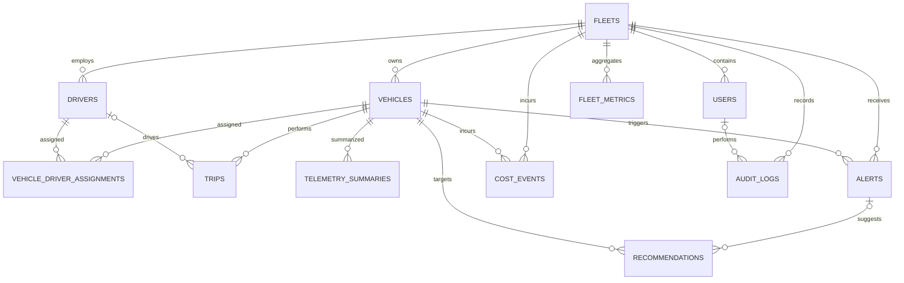

# FleetGuard relational schema

The PostgreSQL schema is defined by SQLAlchemy models in `backend/app/db/models.py` and managed with Alembic. IDs are UUIDs. Fleet-owned records carry a fleet foreign key to support tenant scoping at query boundaries.

Indexes cover fleet ownership/status, vehicle trip chronology, alert/cost chronology, summary windows, metric windows, and driver assignment periods. Unique constraints prevent duplicate vehicle codes within a fleet, duplicate summary/metric windows, duplicate user emails, and duplicate cost event keys.

Raw high-volume telemetry is intentionally not stored in these relational tables; it belongs in the event and document storage layers planned separately.
