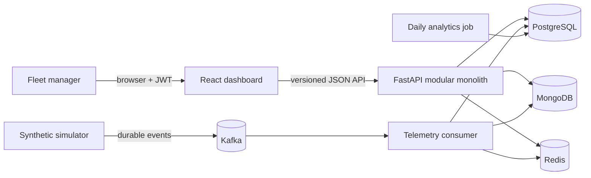
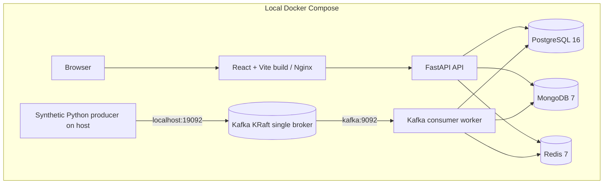
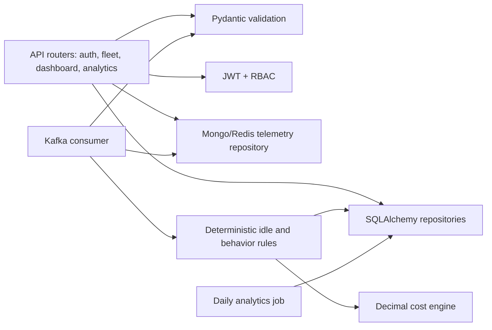
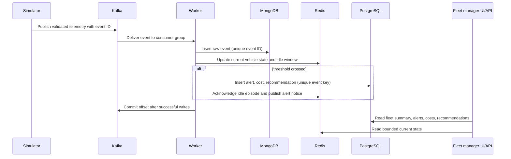

# Architecture

## System context



## Containers and responsibilities



## Backend components



## Event sequence



## Failure sequence

```mermaid
sequenceDiagram
  participant K as Kafka
  participant W as Worker
  participant M as MongoDB
  participant P as PostgreSQL
  K->>W: Deliver event
  W->>M: Insert raw document
  M-->>W: Inserted
  W->>P: Persist alert/cost and DB is unavailable
  P--xW: Storage error
  Note over W,K: Worker exits without committing the event offset
  W->>K: Restart and receive event again
  W->>M: Insert same event ID
  M-->>W: Duplicate key; continue idempotently
  W->>P: Retry relational writes
  P-->>W: Persisted
  W->>K: Commit offset
```

The diagram describes intended retry behavior. A distributed transaction is not used; crash windows still require failure-injection testing.

## Persistence map

| Store | Data | Why |
| --- | --- | --- |
| PostgreSQL | Fleet/user/vehicle relations, trips, summaries, alerts, recommendations, costs, metrics, audit events | Transactions, constraints, indexes, relational ownership |
| MongoDB | Raw telemetry event documents keyed by event ID | Flexible event records and high-volume event history |
| Redis | Current state, idle episode state, alert pub/sub notice | Low-latency expiring state and atomic Lua updates |
| Kafka | Durable telemetry topic and consumer offsets | Producer/consumer separation and replayable event delivery |
| Vector store | None | Current rule-based recommender has no semantic corpus to retrieve |

## Why these technologies

- **Kafka:** buffers telemetry independently of consumers and supports replay via offsets. The checked-in Compose broker is a single-node demo, not a production cluster.
- **PostgreSQL:** normalized fleet relationships, idempotency constraints, transactional alerts/costs, and analytics aggregates.
- **MongoDB:** event-shaped raw telemetry with a unique event key and vehicle/time index.
- **Redis:** hot current state and atomic idle-duration tracking; expiry bounds state growth.
- **FastAPI:** typed request validation, versioned endpoints, OpenAPI, and dependency injection.
- **React/TypeScript:** responsive role-aware dashboard; it polls bounded API snapshots every five seconds.
- **Vector capability:** deliberately omitted until semantic retrieval offers a measured benefit.

## Deployment architecture

The local layout is verified through Docker Compose when the engine is available. A cloud deployment would use managed PostgreSQL/MongoDB, a multi-broker Kafka cluster, Redis HA, private networking, TLS, managed secrets, and separately scaled API/consumer replicas. Cloud deployment is a target only; it has not been performed.
